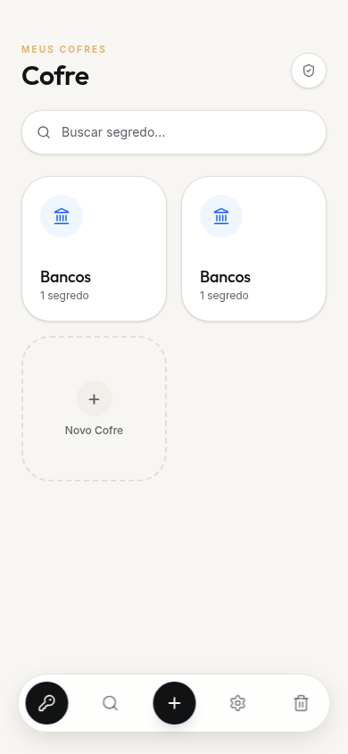
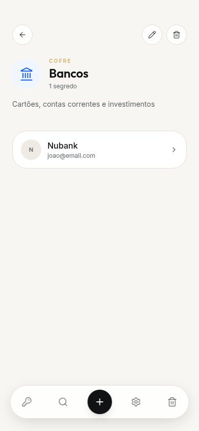
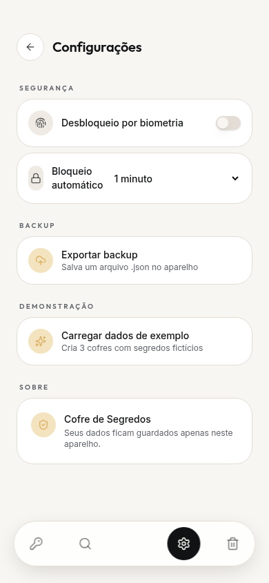

# Cifra

**Gerenciador de senhas para Android.** Guarda senhas e informações pessoais **criptografadas no próprio aparelho**, com desbloqueio por senha mestre ou biometria e sincronização com um app de Windows por Bluetooth.

Projeto pessoal de estudo em segurança da informação, desenvolvido com apoio de ferramentas de IA.

  
  
  

Telas com dados de exemplo.

## O que ele faz

- Organiza segredos em **cofres** (ex.: Bancos, E-mails), com ícone, cor e descrição.
- **Busca** entre todos os segredos.
- **Lixeira** com restauração; itens expiram em 30 dias.
- **Backup** criptografado (`.cofrebackup`) para exportar e importar.
- **Desbloqueio por biometria** opcional.
- **Sincronização com o PC** (app Windows em `windows-app/`) por Bluetooth Low Energy, autenticada por código temporário de seis dígitos.

## Como a segurança funciona

| Parte | Como foi feito |
|---|---|
| Chave de criptografia | Derivada da senha mestre com **PBKDF2-HMAC-SHA256** (210.000 iterações) e salt aleatório |
| Dados | **AES-256-GCM** com IV aleatório de 12 bytes a cada gravação (confidencialidade e integridade) |
| Biometria | A senha mestre é cifrada com uma chave AES do **Android Keystore**, que não sai do sistema; o desbloqueio passa pela biometria do aparelho |
| Backup e sincronização | Viajam já criptografados; a senha mestre **nunca** é enviada por Bluetooth |

Código principal: [`CryptoManager.kt`](app/src/main/java/com/cofredesegredos/crypto/CryptoManager.kt), [`BiometricMasterKeyStore.kt`](app/src/main/java/com/cofredesegredos/security/BiometricMasterKeyStore.kt) e o protocolo em [`SYNC_BLUETOOTH_PROTOCOL.md`](SYNC_BLUETOOTH_PROTOCOL.md).

## Tecnologias

Kotlin · Jetpack Compose (Material 3) · Android Keystore · C# / .NET 8 WPF (app Windows) · Bluetooth Low Energy

## Rodar o projeto

1. Abra a pasta no **Android Studio** (Android 8.0+ / API 26).
2. Rode o app no emulador ou no celular.
3. Testes: `./gradlew :app:testDebugUnitTest`

O app Windows tem instruções próprias em [`windows-app/README.md`](windows-app/README.md).

## Limitações conhecidas

- Projeto de estudo, **sem auditoria de segurança independente**. Não use como único lugar para guardar credenciais importantes.
- A chave do Keystore usada pela biometria ainda não é vinculada à autenticação do usuário (`setUserAuthenticationRequired(false)`); o próximo passo é exigir biometria no próprio Keystore via `CryptoObject`.
